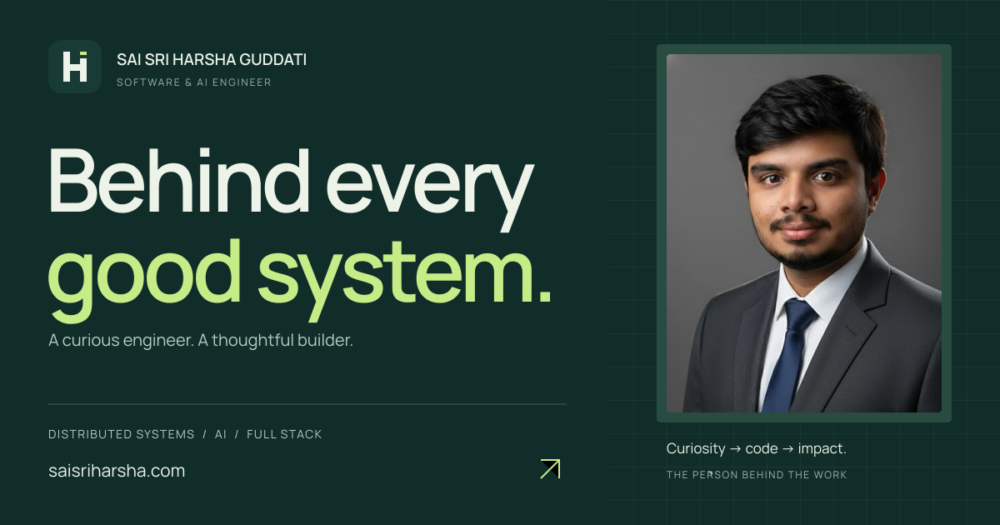

# Hi, I'm Harsha.

I’m an **Infrastructure Platform Engineer IV at University of Florida IT**. I build and operate AI gateways, real-time services, retrieval pipelines, and the interfaces connected to them.

[Explore my website](https://www.saisriharsha.com/?utm_source=github&utm_medium=profile&utm_campaign=portfolio_refresh) · [Experience](https://www.saisriharsha.com/experience) · [Journal](https://www.saisriharsha.com/blog) · [LinkedIn](https://www.linkedin.com/in/sai-sri-harsha-guddati-552373180/) · [Email](mailto:saisriharshaguddati1@gmail.com)

## The work behind the code

- **University of Florida IT:** maintain and extend a LiteLLM gateway on a **shared platform processing 9B+ tokens/day**; led NaviGator Prompt Builder; real-time delivery for 2,000+ concurrent streams; operate 10+ Kubernetes microservices.
- **Tata Consultancy Services:** Systems Engineer, August 2022–December 2023. Java Spring Boot and Node.js services supporting 100K+ daily interactions, SQL optimization, asynchronous workers, and GitLab CI/CD.
- **Academic background:** M.S. Computer Science, University of Florida (completed 2025); B.Tech Computer Science, JNTU Kakinada (2022).

## Selected projects

| Project | What it explores |
| --- | --- |
| [IntentGuard](https://github.com/saisriharsha19/IntentGuard) | Alpha Python + LiteLLM command-line risk analysis |
| [AppTrack](https://github.com/saisriharsha19/AppTrack) | Event ingestion, analytics, and observability |
| [WebLMS](https://github.com/saisriharsha19/WebLMS) | A context-aware AI browser copilot |
| [RAG Agent](https://github.com/saisriharsha19/RAG_Agent) | Embeddings, semantic search, and multi-document reasoning |
| [Vision AI](https://github.com/saisriharsha19/Vision-AI) | Full-stack, document-grounded conversation |
| [Compiler Design](https://github.com/saisriharsha19/CompilerDesign) | A Delphi / Pascal interpreter with ANTLR and AST execution |
| [Distributed Data Scraper](https://github.com/saisriharsha19/data-scraper) | High-throughput, fault-tolerant data collection |
| [ML Redaction System](https://github.com/saisriharsha19/ML-Based_Redaction_Name_Prediction_System) | Entity detection and privacy-aware NLP |

[See the full project archive →](https://www.saisriharsha.com/portfolio)

## Technical focus

- **Languages:** Python, Java, TypeScript, SQL, C++, Bash
- **Backend:** FastAPI, Flask, Spring Boot, REST, async processing
- **Data & infrastructure:** PostgreSQL, Redis, MongoDB, Kafka, Docker, Kubernetes
- **Cloud & delivery:** Kubernetes, Docker, Terraform, F5 load balancing, GitLab CI/CD
- **AI:** LiteLLM, RAG, hybrid retrieval, pgvector, model evaluation
- **Observability:** Prometheus, Grafana, structured logs, metrics

## How I approach engineering

Measure before optimizing. Reliability over cleverness. Simple systems scale better. Infrastructure as code, and documentation as a first-class feature.

If you're building AI platforms, backend systems, or developer infrastructure, [let's talk](https://www.saisriharsha.com/contact).
